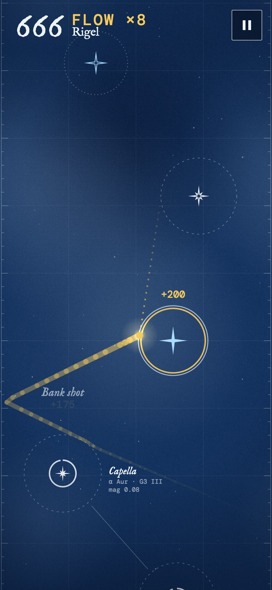
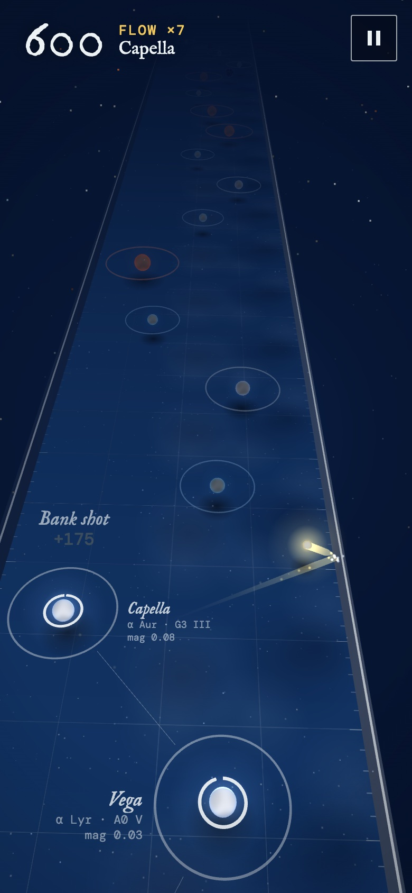

<div align="center">

<h2>Can a browser game built in a chat become a native iPhone game without changing a single rule?</h2>

[](https://github.com/glukicov/perihelion/actions/workflows/ci.yml)
[](LICENSE)
[](PerihelionKit/Package.swift)
[](PerihelionKit/Package.swift)
[](PerihelionKit/Tests)
<br>
[](https://glukicov.github.io/perihelion/web/perihelion-2d.html)
[](https://glukicov.github.io/perihelion/web/perihelion-3d.html)

**[Play](#play) · [Results](#results) · [What we learned](#what-we-learned) · [Quickstart](#quickstart) · [Layout](#layout) · [Rules](docs/RULES.md) · [Write-up](docs/WRITEUP.md)**


&nbsp;&nbsp;


</div>

**Perihelion is a one-button game about a comet hopping between stars.** Tap to let go of your star, catch the next
one before this one burns out. The stars come in order of real apparent brightness, from Sol and Sirius down to
Hamal, drawn as a cyanotype star chart. It started as a single HTML file built in a chat over two evenings; this
repo turns it into a native iPhone game.

The first milestone is the unglamorous one: a pure Swift rules engine that provably plays the *same* game as the web
version, tick for tick. Proving that turned out to be more interesting than porting it.

**TL;DR**

- ☄️ **The rules engine is ported:** plain Swift, no UI imports, a fixed 120 Hz step, the web version's own random
  generator bit for bit, and an event stream for sound and haptics to listen to.
- 🔁 **Nine replays prove it.** The web file's rules run headless, an autoplayer records its taps, and the Swift engine
  replays them: same events on the same ticks, positions within 2×10⁻⁶, same score, for up to 36,000 ticks and 424 stars.
- 🧭 **JavaScriptCore and V8 play different games.** Same seed, same taps, and the engines behind Safari and Chrome
  part ways after about 2,800 ticks (one run ends on 14,465 points in Safari's engine and 35,615 in V8). Last-bit differences in
  `hypot`, `sin` and friends, amplified by every capture.
- 🎯 **The aim line fibs after a wall bounce**, by a few units, because it folds at the walls differently from the real
  flight. Found by an autoplayer that trusted it and kept dying.
- 📱 **The iPhone app itself is next:** renderer, sound, haptics, Game Center.

**The long version is [`docs/WRITEUP.md`](docs/WRITEUP.md)**, and the full rules are in [`docs/RULES.md`](docs/RULES.md).

## Play

The web versions are single, self-contained HTML files: [2D](https://glukicov.github.io/perihelion/web/perihelion-2d.html)
and [3D](https://glukicov.github.io/perihelion/web/perihelion-3d.html) (three.js). Tap, click or press Space to let go,
and Escape to pause. Leave on your first lap to build flow.

## Results

Each run replays the web version's rules (as run by JavaScriptCore, Safari's engine) against the Swift engine. Runs
that are still alive at five minutes of game time stop there.

| Run | Game time | Stars reached | Score | Ending | Swift vs web | V8 vs web |
|---|---:|---:|---:|---|:---:|---:|
| steady | 5:00 | 373 | 66,110 | still going | ✅ identical | differs from tick 2,857 |
| greedy | 5:00 | 418 | 80,290 | still going | ✅ identical | differs from tick 6,200 |
| deep | 5:00 | 424 | 82,025 | still going | ✅ identical | differs from tick 4,713 |
| reckless | 1:09 | 88 | 14,465 | lost in the dark | ✅ identical | differs from tick 2,758 |
| hesitant | 0:54 | 28 | 2,120 | Miaplacidus burned out | ✅ identical | same |
| snake | 0:29 | 30 | 3,615 | lost in the Snake Nebula | ✅ identical | same |
| wild | 0:25 | 22 | 3,955 | lost in the dark | ✅ identical | same |
| horsehead | 0:25 | 21 | 2,380 | lost in the Horsehead | ✅ identical | same |
| title-then-burnout | 0:21 | 12 | 1,875 | Altair burned out | ✅ identical | same |

"Identical" means every event on the same tick with the same payload, the comet within 2×10⁻⁶ chart units at every
event, matching checkpoints every 2 seconds (including where the aim line points), and the same final score, stats
and cause of death.

## What we learned

1. **"Matches the web version" needs a browser attached.** JavaScript's `Math` functions are not the same everywhere.
   V8 ships its own; JavaScriptCore calls Apple's libm, like Swift does. Over a long run the game is chaotic enough
   that one ulp becomes a different ending, so the fixtures come from JavaScriptCore, and Swift matches them exactly.
2. **Test the rules, not the frames.** The web game's "dropped off the bottom" rule quietly depended on the frame rate,
   via a camera eased per rendered frame. The engine eases it per tick, so a run is the same at 60 Hz, 120 Hz or in a
   unit test.
3. **Cut the reference out of the shipped file.** The harness slices the rules straight out of the HTML by their
   section markers, so a change to the web game shows up as a fixture diff instead of a silent drift between copies.
4. **An autoplayer is a cheap bug hunter.** It trusted the aim line and kept dying just after wall bounces, which is
   how the aim line's fold error surfaced.

## Quickstart

You need macOS with Xcode 16 or later (Swift 6), plus [just](https://github.com/casey/just) and Node 22 if you want to
regenerate the fixtures.

```bash
just test          # replay the nine web runs against the Swift engine
just play          # open the 2D web version (just play 3d for the 3D one)
just fixtures      # re-record the reference runs from web/perihelion-2d.html
just screenshots   # re-take the README screenshots with headless Chrome
```

## Layout

```
PerihelionKit/                 Swift package
  Sources/PerihelionCore/      rules engine: Game, stars, nebulae, events, Mulberry32
  Tests/PerihelionCoreTests/   replay tests and the nine JSON fixtures
web/
  perihelion-2d.html           the original game, and the reference for the rules
  perihelion-3d.html           the same rules in a three.js scene
  playtest/                    Playwright play-tests for the web builds
tools/
  reference.mjs                runs the web rules in JavaScriptCore and V8, writes fixtures
  screenshots.mjs              README screenshots via the Chrome DevTools protocol
docs/
  RULES.md                     every rule and constant
  WRITEUP.md                   the long version of this README
```

> [!IMPORTANT]
> **Caveats.** This is the engine, not the game yet: there is no iPhone app in the repo so far. The fixtures were
> recorded with the JavaScriptCore and libm in macOS 27, and the "V8" comparison used Node 22, not a Chrome build.
> Exact replays rely on Apple's libm staying put; a future OS update could, in principle, nudge a last bit and break a
> long fixture without anything being wrong with the game. The engine's camera steps per tick rather than per frame,
> a deliberate difference from the web version that only affects exactly when a falling comet is declared lost.

## Credits

Fonts are [IM Fell English](https://fonts.google.com/specimen/IM+Fell+English) and
[DM Mono](https://fonts.google.com/specimen/DM+Mono) (SIL Open Font License). The 3D version uses
[three.js](https://threejs.org) r128 (MIT). Star names, designations, spectral classes and magnitudes are from the
standard lists of the brightest stars.
